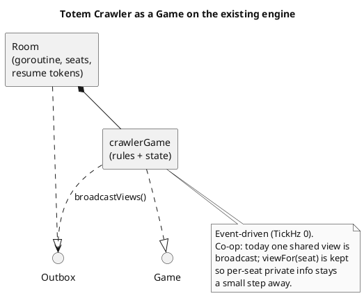
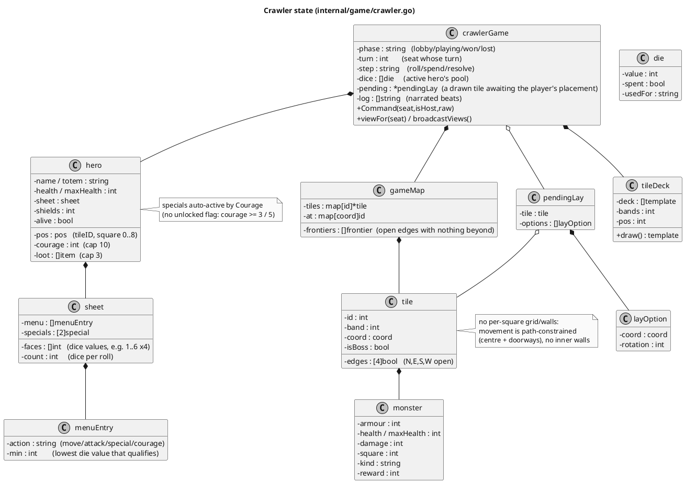
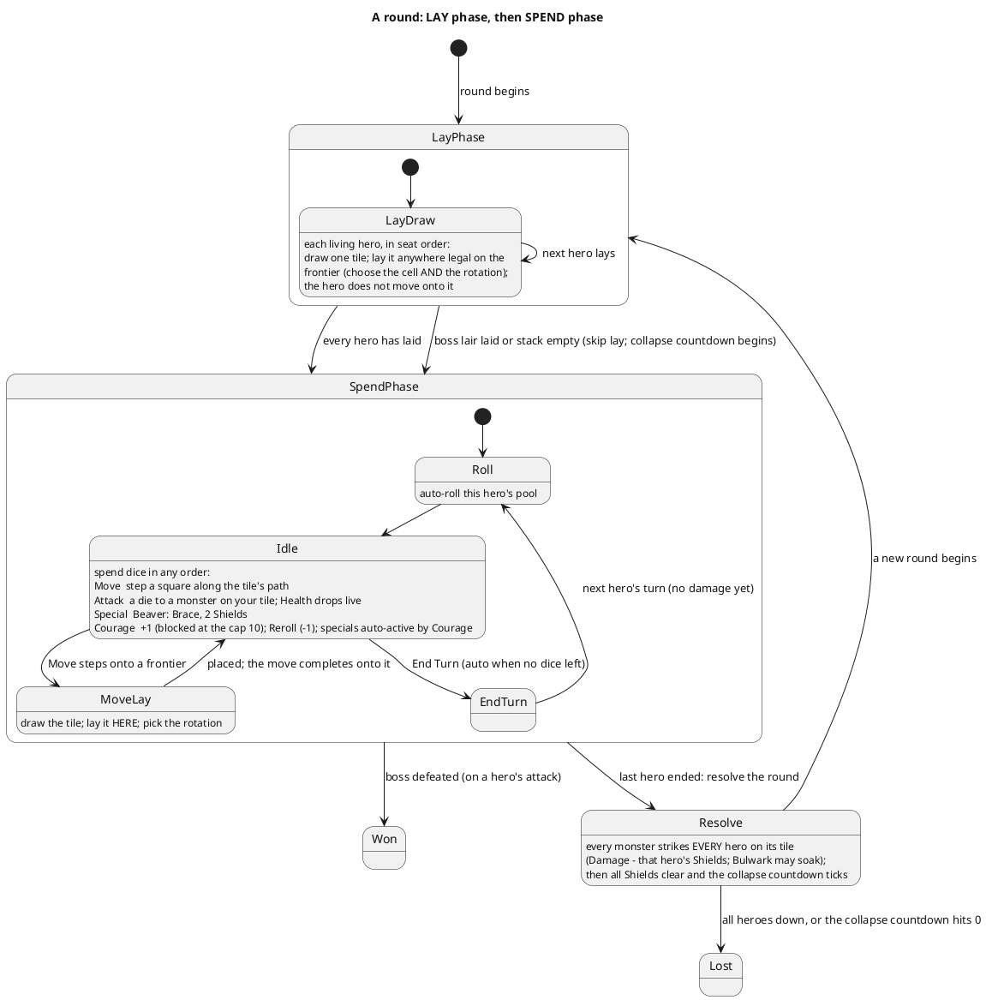
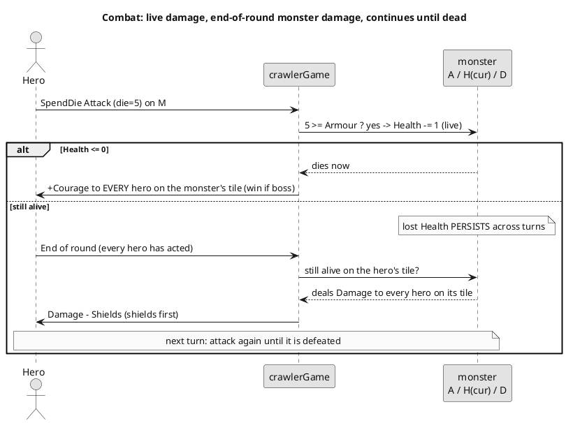
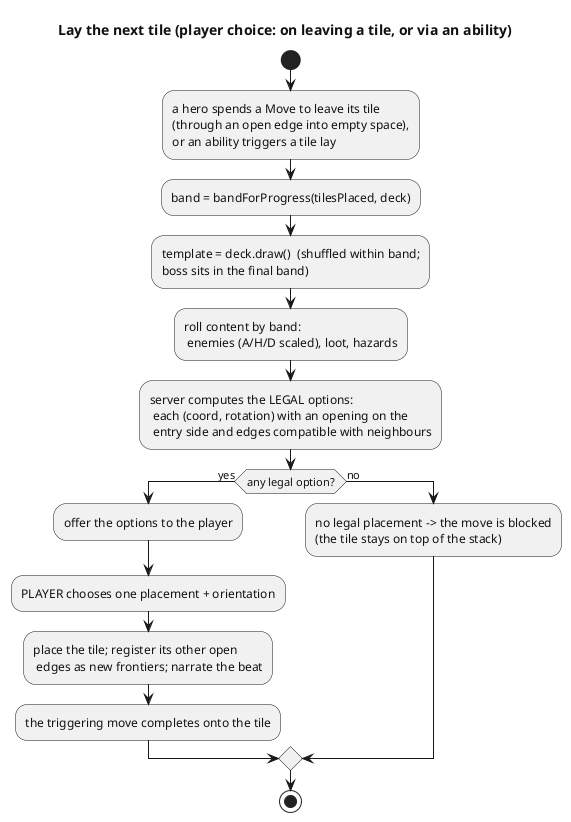

```table-of-contents
```

# Totem Crawler: architecture & spec

The technical spec for the original co-op dungeon crawler. The product brief (theme, inspirations, character fiction, task list) lives in the design note [[Totem App - Interactive Dungeon Crawler]]; this document is the implemented architecture: the data model, the turn rules as the code enforces them, the random tile generator, the wire protocol, and the test plan. It began as a before-any-code spec and now tracks what shipped. Numbers marked "tune" are placeholders to playtest, not architecture.

The crawler is one more `Game` on the existing multiplayer engine (see [[TotemApp-IT-Games]] for the engine). It is turn-based and co-op, so it reuses rooms, reconnection, the totem sprite atlas for hero avatars, and the `useRoom` client transport unchanged. Nothing about the netcode is new; what is new is a much larger game state and a richer turn.

> [!note] Status: built and verified on DEV
> The backend is split across `internal/game/crawler.go` (state + turn flow + command dispatch), `crawler_deck.go` (tile templates + banded deck + enemy generation), `crawler_sheets.go` (character sheets + dice), `crawler_combat.go` (attacks, the end-of-round group fight, shields, healing, rewards, drops), `crawler_view.go` (the per-seat DTOs + `viewFor`), `crawler_bosses.go` (the boss pool + multi-level progression), `crawler_objects.go` (the loot economy and shop) and `crawler_hazards.go` (hazards + statuses). The client is `src/web/src/games/crawler/CrawlerPage.tsx` with the pure, unit-tested helpers (tile-art rotation, walk-sprite direction, effective Armour) in `logic.ts`. Combat is a **group fight** resolved at the end of the round, several robots share a tile, and movement is **path-constrained** (a hero stands only on the centre and the doorway of each open edge, corners off-path), so a straight is a corridor and a bend turns without a full inner-wall model. The one simplification still standing is no fine inner tile walls. This document is the architecture of record; the [changelog](../CHANGELOG.md) records each step.

## UML notation

Every diagram is PlantUML, rendered inline by Obsidian, forced monochrome on a white canvas so it stays readable in any theme. Four kinds are used: a **class diagram** for the Go state model, a **state diagram** for one hero's turn, an **activity diagram** for the tile generator, and a **sequence diagram** for combat. Arrows read as in the engine doc: `A ..|> B` "A implements B", `A *-- B` "A owns a B", `A o-- B` "A holds Bs".

## Scope: what the crawler is

A full vertical slice of the real game, built on the random tile generator chosen at kickoff and since grown with the loot economy, the boss pool and multi-level progression, and the hazard/status system. The core build:

**Core build**

- A new `crawlerGame` on the engine (slug `crawler`), event-driven (`TickHz 0`), co-op, 1 to 6 heroes, one hero per seat.
- **A round has two phases, each sweeping the party once in seat order.** First the **LAY phase**: every living hero draws one tile and lays it (see below), extending the map before anyone acts. Then the **SPEND phase**: each hero rolls a dice pool and spends each die through the sheet's action menu (Move, Attack, Special, Courage; reroll a die for 1 Courage), then ends their turn. After the last hero spends, a new round opens again at the LAY phase.
- Movement square by square across a 3x3 tile grid, constrained to the tile's path (centre plus the doorway of each open edge; corners are off-path).
- **Tiles are laid two ways.** In the LAY phase the lay is **proactive and mandatory**, and the player chooses **both the cell and the rotation**: the server offers every legal placement of the drawn tile across the whole frontier (any cell, any rotation that fits its neighbours and joins the map), the hero drags it where its doorways line up, and the hero does **not** move onto it. Because any frontier is in play, a hero whose own tile is fully surrounded still gets to lay elsewhere. In the SPEND phase the lay is **move-triggered** and **rotation only**: stepping out of your tile onto an empty frontier draws the next tile, lays it **at that frontier** (the location is fixed by where you stepped), you pick the rotation, and the move completes onto the new tile. A move onto an empty frontier with no legal placement is blocked.
- Random tile generation from a banded stack (easy early, nasty late) with named tile types (straight, bend, tee, cross, dead-end) and the boss shuffled into the final band. Tiles lay on all four sides, and an offered orientation always opens on the side you entered from, so the path always **connects** (you can never lay a tile whose path does not join the one you came from).
- Combat against static enemies (Armour / Health / Damage): hits land live and a monster's lost Health **persists across turns**, so allies on a tile pool their blows (the **group fight**). Retaliation is at the **end of the round**, after every hero has acted: each monster still alive strikes **every living hero on its tile** for its Damage (minus that hero's Shields). The Beaver's Bulwark can soak an ally's hit.
- Courage economy (earn on high dice and on kills, spend on rerolls) and Shields. **Shields are a per-round resource** (cleared after end-of-round combat; Thick Hide re-grants its 2 next round). **Specials auto-activate** at their Courage threshold (3, then 5) and switch off again if Courage drops below it: there is no manual unlock. Courage is capped at 10, and the Courage action is unavailable at the cap.
- Six designed totems (Beaver, Arrow Squid, Wolf, Treefrog, Raccoon, Comoros Weaver) with their own health, dice count, **weighted die type** (Low/Balanced/High) and menu; other totems fall back to a generic sheet. Both the inherent specials (Brace, Mend, Carry, Pilfer, and the generic Guard) and the Courage-tier unlocks are wired to effects (see [Characters and sheets](#characters-and-sheets)), including Spores (the Treefrog's Mend clears statuses) now the hazard/status system exists.
- Win (boss defeated) and lose (party wiped, or the dungeon collapses). The collapse countdown (5 turns) begins the moment the **boss lair is laid** (or, as a fallback, when the tile stack runs out): no further tiles are laid and the party must reach and defeat the boss before the countdown is up. Plus a per-tile narrated beat. On a loss the host can **New run** (back to the lobby) or **Try level again** (`retryLevel`): replay the current level from scratch, a fresh map and party, with all objects lost.
- **No dice left auto-ends the turn** (you do not have to click End turn once every die is spent).
- Client: heroes are drawn from the **Bomberman totem sprite atlas** (not emoji), the player's **character sheet** sits at the top (sprite, health bar, resources, the action menu and the two specials), and hovering a monster shows its stats.
- A seeded RNG so a whole run reproduces, and a first-class test suite.

**Deferred (later)**

- Reaction dice (allies spending dice on another hero's turn, an interrupt mechanic) — distinct from the shipped end-of-round group fight.
- Richer per-tile story beats and a balancing pass. (The scout ability and the hidden-enemy-stats reveal were both dropped; the friends' totems are mapped onto the six archetypes and playable.) **Mobile UI landed**: the default view is now a collapsible left **party rail** (each hero's expanded controls on their turn, compact cards for the others) beside the board, plus an **on-pawn touch overlay** (dice with per-die reroll, a move d-pad, the action bars, a Courage bar with unlock ticks, items, portal arrows, carry/ally taps) that anchors on your hero, a **board drag-to-pan**, and board combat where a reachable enemy (own tile or ranged/Scope reach) **pulses, is clicked to target, then shows a ⚔** that attacks it (independent of the overlay); hovering the sidebar's Attack bar rings the same enemy it will hit. The classic top-panel view ("V1") was retired in 0.24.0, so the sidebar + on-pawn layout is the only one. Two visibility aids: a **start-of-level title card** (the boss's sprite, name and signature twist, the total tile count, and a shuffle animation; it does not auto-hide, the player dismisses it with ✕ / Begin once the shuffle plays; backed by the view's `bossName` / `bossSlug` / `bossTwist` / `levelTiles` and `levelBoss()`), and a **start-of-round warning banner** (last 10 tiles: "X tiles left! Boss near"; stack empty: the collapse countdown "N turns left").

## Why it fits the engine as-is



The crawler implements the same `Game` interface as the card games: `AddPlayer` seats a hero, `Command` applies a client frame, `viewFor(seat)` renders the view and `broadcastViews()` pushes it on every change, `TickHz()` returns 0. The game is co-op, but `viewFor` is still per-seat: each hero's own dice pool, action menu and free-reroll state ride only on that seat's view, while the shared map, party and log are the same for all.

## Core data model



A `pos` is a tile id plus a square index 0..8 (row-major over the 3x3). An `edge` direction is 0..3 for N,E,S,W. A `coord` is the tile's integer `(x,y)` on the abstract map grid. Movement is constrained to the tile's path (centre plus each open doorway); there is no per-square inner-wall model.

## Assets and sprites (where art lives)

Game art is **not** in the database. The data model above is pure game state (and the DB schema in the main [README](../README.md#data-model) is the animal catalogue); sprites and other art are **static files** served by the SPA. The flow is the same one Bomberman already uses: a file under `src/web/public/` is copied verbatim by Vite into `src/web/dist/`, which `totemd` serves at the root path and, in production, embeds into the single binary via `embed.FS`. No API call, no DB row, no server round-trip to fetch art.

| Asset | Where it lives | Served at | Notes |
| --- | --- | --- | --- |
| **Hero totems** (in use) | `src/web/public/sprites/totems.{png,json}` | `/sprites/totems.png` | The shared atlas, one row per animal (see the main README's [Totem sprites](../README.md#totem-sprites)). The crawler draws each hero's **front frame** (column 0 of its row) via a CSS background, reusing the Bomberman art with no extra fetch. `SPRITE_ROWS` in `CrawlerPage.tsx` holds the row order. |
| **Map tiles** (in use, 0.4.4) | `src/web/public/sprites/crawler/tiles/<biome>/tile-<i>.png` | `/sprites/crawler/tiles/*` | Split from a grid sheet by [`scripts/make_tiles.py`](../scripts/make_tiles.py). Tiles are foldered **per biome** (`woodland/`, `ruins/` and `machine/`, all in use); the client picks the folder from the level's biome (`biomeTileDir` + `HAVE_TILES` in `logic.ts`), falling back to `woodland` for a biome whose sheet has not landed. `TILE_ART` maps each engine `kind` to a file and the client rotates it to the laid orientation. |
| **Object icons** (in use) | `src/web/public/sprites/crawler/objects/<slug>.png` | `/sprites/crawler/objects/*` | Split from a 4x4 sheet by [`scripts/make_objects.py`](../scripts/make_objects.py). The client (`ObjIcon`) shows the icon with an emoji fallback. |
| **Enemies** (in use, 0.4.7+) | `src/web/public/sprites/crawler/enemies/<slug>/<pose>.png` | `/sprites/crawler/enemies/*` | Split from a sheet by [`scripts/make_enemies.py`](../scripts/make_enemies.py) (flat background stripped). Each monster carries a `kind` on the wire (the note's robot archetypes); the client maps it to a sprite (`MonsterSprite`): **scrapling** (A3 H1 D1, reward 1, swarm), **sentry** (A5 H1 D3, reward 1, hard to hit), **hulk** (A3 H4 D3, reward 2, soak it), **jammer** (A3 H2 D1, reward 2, +1 Armour to other robots on its tile), **grappler** (A4 H2 D1, reward 2, its clamp can Snare), and a **boss** drawn from the level's biome pool (see [Bosses and multi-level progression](#bosses-and-multi-level-progression)). Scrapling, Hulk, Jammer and Grappler have art, Sentry reuses the former bruiser sheet as a stand-in, and bosses without their own sheet fall back to the generic boss sprite. Each draws its `idle` frame, its `attack` frame plus a lunge while **engaged**, or its `destroyed` frame once defeated (dimmed, no stat badge). The board badge is `🛡armour ❤health 💥damage ✊reward`. Loot art is not wired yet. |

**How map tiles are loaded.** Unlike the totem atlas, tiles are kept as **individual PNGs** (not one atlas): the client rotates each tile independently to the orientation it was laid in, and rotating a shared atlas viewport would rotate its neighbours too. The pipeline:

1. `scripts/make_tiles.py SHEET --rows R --cols C` cuts a grid sheet into `tile-<i>.png` (one PNG per cell, in reading order) under `sprites/crawler/tiles/`, plus a `tiles.json` manifest. It is the tile counterpart of `make_sprites.py`. Write into a biome with `--out sprites/crawler/tiles/<biome>`; trim a frame with `--inset`, resize with `--size`. Two knobs pick tiles: **`--start N`** numbers the first written tile `tile-N` (not `tile-0`), and **`--only K`** writes just cell K (0-based, reading order) named by `--start`. So `--start` says what to call the output and `--only` says which cell to take. The manifest is **merged**, so writing a few tiles never drops the rest. Examples: a full 3x3 is `--rows 3 --cols 3`; one corrected tile over `tile-3` is `--rows 1 --cols 1 --start 3`; the first cell of a 9x9 sheet written as `tile-9` is `--rows 9 --cols 9 --only 0 --start 9`. The script's header docstring carries the full recipe list.
2. `TILE_ART` in `src/web/src/games/crawler/logic.ts` maps each engine `kind` to a file and the open **edges as drawn** (N,E,S,W). On render, `tileArt(kind, edges)` finds the rotation (0/90/180/270) where `rotateEdges(base, r)` equals the tile's actual edges and applies it, so the drawn doorways line up with the real connectivity. The art sits in a layer **behind** the pawn/monster grid (`.cr-tile-art`, `z-index 0`) so pieces stay upright over a rotated tile.
3. A kind with no entry (or whose PNG is missing) falls back to the styled cell, which still shows the gold doorways and the type label, so connectivity is never ambiguous. Adding art later is a one-line `TILE_ART` edit, no protocol change (`kind` and `edges` are already on the wire).

**Which number is which tile (the authoritative map is `TILE_ART` in `logic.ts`).** When you split a biome sheet with `make_tiles.py`, cell N (reading order) must be the kind below. The woodland sheet is laid out in exactly this order:

| File      | Kind     | Shape                                                    |
| --------- | -------- | -------------------------------------------------------- |
| `tile-0`  | dead-end | one doorway                                              |
| `tile-1`  | straight | corridor (two opposite edges)                            |
| `tile-2`  | bend     | corner (two adjacent edges)                              |
| `tile-3`  | tee      | T-junction (three edges)                                 |
| `tile-4`  | cross    | crossroads (all four)                                    |
| `tile-5`  | healing  | healing spring (Woodland: T-junction; Ruins/Machine: 4-way cross) |
| `tile-6`  | portal   | transporter / start (drawn as a crossroads)              |
| `tile-7`  | shop     | kangaroo shop (a dead-end nook)                          |
| `tile-8`  | boss     | boss lair (a crossroads the boss holds)                  |
| `tile-9`  | vault    | loot cache, a dead-end nook (L2+); drops its consumable on the floor when laid |
| `tile-10` | shrine   | a landmark (cosmetic, Level 2 only)                      |
| `tile-11` | gate     | the broken city gate: L2 boss lair + L3 start (dead-end) |
| `tile-12` | wiring   | live-wiring hazard room (Woodland L2+)                   |
| `tile-13` | coolant  | coolant-flood hazard room, a crossroads (Woodland L2+)   |
| `tile-14` | fog      | sensor-fog hazard room, a crossroads (Woodland L2+)      |
| `tile-15` | rust     | rust hazard room, a crossroads (Ruins L3+)               |
| `tile-16` | trap     | trap/mine hazard room, a straight corridor (Ruins L3+)   |
| `tile-17` | overheat | overheat/fire hazard room (Machine L5+)                  |
| `tile-18` | descent  | the stairwell down: L4 boss lair (dead-end)              |

Art for `tile-10` and up is not ingested yet, so those tiles fall back to the styled cell (the `backgroundImage` 404s silently) until their sheets land; the `TILE_ART` rows and `buildDeck` entries are already wired. To change which cell a kind uses, edit that kind's `file` (and `base`, the drawn open edges) in `TILE_ART`; nothing else changes. Because the server sends each tile's chosen `rot`, `tileArt` can rotate even a symmetric tile (the crossroads) for variety while still lining asymmetric tiles up with their real edges. A kind's `file` may also be a **list of interchangeable variants** (same shape / open-edge count): `tileArt` then picks one per tile by its id (`pickVariant`, deterministic so it never flickers on re-render), giving a kind several looks with no server change. Variants are **biome-aware**: a look that exists only in some biomes is registered in `BIOME_VARIANTS` (`logic.ts`), and `pickVariant` offers it only in a biome whose folder actually has it, falling back to the always-present base file elsewhere. So a machine-only look (the crossing variants `tile-4b`/`tile-4c`) never blanks out a woodland or ruins crossing.

**Per-level tile roster.** Each level's stack is built from the **exact per-level counts in the note's tile table**, not a weighted random draw: `levelPathCounts` (`crawler_deck.go`) gives the number of each base path tile for the level, and the special set splits into **essential services** (`essentialSpecialTiles`: two healing springs, the transporter(s), the shop) and **mixable rooms** (`mixableSpecialTiles`: the Vault, hazard rooms, the shrine). On every level that is the base paths, two transporters, two healing springs (a 3-way T-junction in the Woodland, a 4-way cross in the Ruins and Machine, per the `heal` spec in `essentialSpecialTiles`), the shop and the boss; the start tile is a transporter placed separately by `startLevel`, so it is not in the deck. The essential services are **dealt into the stack above the boss** (`insertBeforeBoss`), exactly like the board game, so no shuffle can ever bury a service behind the boss where it could never be laid (laying stops the moment the boss lair is on the map); the mixable rooms are shuffled into the difficulty bands and may sit in the last few tiles behind the boss. The **Vault** comes in from Level 2; and, also from Level 2, the **hazard rooms**. The Woodland hazard rooms (**live-wiring**, **coolant-flood**, **sensor-fog**) come in at Level 2 and carry forward; the Ruins add **rust** and **trap** rooms at Level 3; the Machine rooms add the **overheat** room at Level 5. The **shrine** (cosmetic) appears at Level 2 only for now. The **city gate** is not a loose deck tile: it does double duty at the woodland -> ruins boundary as the **Level 2 boss lair** and the **Level 3 start tile**. At Level 2 `buildDeck` makes the boss tile a gate (a one-door dead-end) instead of the usual crossroads lair, so the boss is cornered and the party fights it from the single doorway; at the start of Level 3 `startLevel` opens the map on that same gate rather than the crossroads portal, the broken gate the party descends through. The **descent** mirrors this at the ruins -> machine boundary: at Level 4 `buildDeck` makes the boss tile a descent (another one-door dead-end, the stairwell down) instead of the crossroads lair. The two Ruins hazard rooms differ in shape: the **rust** room is an open crossroads like coolant/fog, while the **trap** room is a straight corridor. Because a transporter can only teleport to another transporter, every level keeps a usable pair of two: normally the pre-placed start portal plus one in the deck, but on Level 3 (where the gate is the start) `buildDeck` adds a second deck portal so the pair survives. A hazard room seeds its hazard onto its squares when laid (`seedHazards`); the shrine has no mechanical effect, and level transitions are automatic on a boss kill. See [Hazards and statuses](#hazards-and-statuses) for what each hazard does.

The boss only ever appears in the **final band** of the stack (`buildDeck`, asserted over 40 seeds by `TestCrawlerBossInFinalBand`); a regular monster is never a boss. The essential service tiles (healing springs, transporters, shop) are always laid before the boss (`TestCrawlerEssentialServicesAlwaysBeforeBoss`, 60 seeds x every level).

**Where tile and enemy generation lives (to tune it).** The art mapping above is client-side; the actual *generation* (which tiles and which robots a run contains) is server-side in [`src/internal/game/crawler_deck.go`](../src/internal/game/crawler_deck.go), in three spots that each carry a one-line "this is the place to tweak" comment:

| Want to change | Edit | Notes |
| --- | --- | --- |
| Run length, number of bands, boss stats | `buildDeck` / `levelBossTile` | `levelPathCounts` + the special tiles fix the exact per-level stack size (the note's tile table), and `g.bands` (set in `startLevel`, 3) splits it into difficulty tiers so monster strength escalates. The boss stat line is built in `levelBossTile`; its Armour is a high 5-6 (only strong dice land) and its Health is `baseHP + hpPerHero * (players - 1)` (the roster entry's one-player value plus a per-extra-player bump, see `crawler_bosses.go`) so the fight lasts about the same few rounds at any party size. |
| Special tiles (services vs rooms) and where they land | `essentialSpecialTiles` / `mixableSpecialTiles` | **Essential services** (two healing springs, the transporter(s), the shop) are dealt into the stack ABOVE the boss (`insertBeforeBoss`), so no shuffle buries one behind it. **Mixable rooms** (Vault, hazard rooms, shrine) are spread across the bands round-robin (`s.band = i % bands`), shuffled, and may sit in the boss-clock tail. The start tile is a portal placed by `startLevel` outside the deck, so the one deck portal forms the teleport pair; on Level 3 (where the start is the gate) a second deck portal is added so the pair still exists. |
| Which base path tiles are drawn, and how many | `levelPathCounts` | A `map[kind][6]int`, one column per level, giving the exact count of each base path tile straight from the note's tile table; edit a column to retune a level's path mix (corridors common, dead-ends rare). |
| Which robots spawn, and swarms | `rollMonster(band)` | Returns the robots for one tile as a slice: a lone robot, a pair, or a late scrap swarm of three, weighted per band. `newRobot(kind)` builds one (its stat line baked in). `assignMonsterSquares` lays each robot on a **hero-unreachable** square (the four corners first, then closed-edge midpoints), so a robot never shares a square with a hero; the boss keeps the centre. |

Several robots can share a tile (a swarm): `rollMonster` returns a group, and each robot is laid on its own **hero-unreachable** square (a corner or closed-edge midpoint), so heroes and robots never stack in one square; the boss holds the centre. They are static (no movement), so a swarm is a cluster to clear, not a chase.

Two notes for generating more tile art: it must read for all four **rotations** (the engine rotates the base when laid), and the open **edges** (`tile.edges`) are what line up with neighbours, so the doorways in the art sit at the mid-point of each side (the `crawlerDoor` squares). A tile whose path connects two **adjacent** sides is a bend; one with a single doorway is a dead-end.

**Laying a tile (client).** Both lays send the legal `(coord, rotation)` options in `pending` with a `phaseLay` flag. The client shows the drawn tile as a card with its art, lights every option cell on the board as a pulsing **drop-zone** with a ghost of the tile, and the player **rotates** through the orientations and drops (or clicks) the cell to commit (`layTile`); a chosen rotation is kept across cells, falling back to a cell's own legal rotation only where it does not fit. The `phaseLay` flag drives this: a proactive LAY-phase lay spans the **whole frontier** (many cells, you choose where and how), while a move-triggered lay is a **single cell** (fixed by where you stepped) and only its rotations, so the copy reads "any glowing cell, you move on your turn" versus "the spot is fixed, click to step through". The board is a scroll box that keeps your tile (for a proactive lay) or the stepped-onto cell (for a move lay) centred, so a growing map scrolls rather than shrinking.

## The action menu (the core innovation, as code)

The design's die map resolves to one rule: **each action has a minimum die value, and a die can pay for any action whose minimum it meets** ("you can go down": a high die can do a low action). **Attack has no fixed menu minimum: the monster's Armour is its threshold.** A die lands a hit only if it meets the target's (effective) Armour, so a die below the Armour is **not a legal attack at all** (it is refused, not spent on a guaranteed miss): those low dice go to Move or a Special. The threshold is the enemy, not the menu. The default menu:

| Action | Min die | Effect |
| --- | --- | --- |
| Move | 1 | step one square (a fast totem steps two, directed step by step) |
| Special | 2 | the sheet's signature (Beaver: Brace, 2 Shields to self or an ally on the tile) |
| Attack | the target's Armour | assign the die to a monster in reach; only a die that meets its Armour may be assigned (it then lands a hit) |
| Courage | 5 | +1 Courage (cap 10) |

So a 6 may Move, Special, Attack or Courage; a 1 may Move or Special (it is below every robot's Armour, so it cannot attack). High-biased dice meet Armour far more often, which is why a High die type is a striker's and a Low die type a guardian's. The sheet owns the thresholds, so a totem can deviate (the menu is data, not hard-coded). This is the "every number is useful" promise made mechanical: there is no dead die, only a choice.

**Two input paths, one set of rules.** The mouse path is unchanged: click a die to open its action menu (Move / Attack / Special / Courage), and use objects from the Use buttons on your sheet. On top of that, **keyboard shortcuts** on your turn each auto-spend your **lowest usable die**, so you skip the die-select step: arrows or WASD Move (a fast mover's extra steps go through `step`), `c` gains Courage, `f` attacks (the lowest die that beats some enemy's effective Armour hits the **lowest-Health** enemy it can reach, to finish wounded robots), number keys `1`-`9` use that pack slot's object (auto-targeted exactly like the sheet's Use button), `e` ends the turn, `Escape` clears a selected die, and `v` revives a downed ally on your tile. While **laying a tile**, scrolling over it (or a glowing cell) or pressing `r` rotates it, and `Enter` places it at the previewed spot (the drag/click path and the Rotate button still work). The two paths share their logic: `attackTargets` (who is hittable) and `useItemMsg` (how an object resolves) live in `data.ts` and are called by both the action menu / sheet and the keyboard handler, so they can never drift. A one-line **shortcut hint** shows above the board during a player's first three turns on Level 1, then stays out of the way.

## A round: lay phase, then spend phase



A round always lays before it plays. In the **LAY phase** every living hero draws one tile, mandatory, and lays it anywhere legal on the frontier: the server offers every cell and rotation where the drawn tile both fits its neighbours (`edgesFit`) and joins the map on at least one open side (`connects`), and the hero drags it to the spot where the doorways line up. The hero does not move onto it. Because the whole frontier is in play rather than only the cells next to the hero, a hero whose own tile is boxed in still lays elsewhere.

Two **mapmaking rules** keep the forest from closing shut (without them, a loop or a dead-end on the last open cell could seal the map so no further tiles could ever be laid and the boss never appeared). **Rule 3:** a drawn tile that cannot legally connect anywhere is **cycled past** (kept in the stack, slid behind the next fitting tile and retried as the map grows), never discarded (`drawLayable`/`drawFittingAt` + `cycleToTop`). **Rule 4:** the one placement that would leave **no open edge for any future tile** is never offered (`keepsForestOpen` filters it out of `allLayOptions`/`layOptions`); if a tile's **only** placements would seal the map it is cycled past too, and the scan continues. So the map always keeps at least one open exit, and **only the boss lair is allowed to end the forest** (it is exempt from Rule 4). A hero's lay is skipped only when nothing in the whole stack can be laid. Then the **SPEND phase** gives each hero a dice turn. Dice are rolled once at the start of your turn and spent in any order. Each Attack die is applied **immediately** and the monster's Health drops live; a lethal blow kills it at once. **A monster's lost Health persists across turns**, so allies standing on the same tile whittle a tough enemy down together over the round (the **group fight**). Retaliation is deferred to the **end of the round**: once the last hero has acted, every monster still alive strikes **every living hero on its tile** for its Damage (minus that hero's Shields), the Beaver's Bulwark soaking an ally's hit onto himself while active, and then all Shields clear. Moving onto an empty frontier mid-turn lays a tile there too (the move-triggered lay), with the same rotation-only choice. A ranged totem (Arrow Squid) may spend its Attack on a monster one tile away through an open edge.

Mandatory laying makes the stack drain faster (every hero spends one tile per round before any move-triggered draws), which shortens a run and brings the boss band sooner; `levelPathCounts` and `g.bands` in `buildDeck` are the knobs to retune the run length against the party size if playtests want it longer.

Two quality-of-life rules round out the turn. **Spending your last die auto-ends the turn** (`maybeAutoEnd`): there is nothing left to do, so the player does not have to click End turn. And **the collapse countdown is a race to the boss, not an instant loss**: the moment the **boss lair is laid** (`layTile` calls `startGrace` on an `isBoss` tile; the emptying deck is a fallback trigger), a `crGraceTurns` (5) countdown begins (Hauler, the weak-point boss, gets a longer party-scaled one via `graceTurns()`: **10 solo, 7 at two, 6 at three, 5 at four or more**, since its hidden core must be hunted down first), no further tiles are laid (`beginLayPhase`/`beginLayTurn` skip once `grace >= 0`), and each end of turn ticks it down; the run is lost only if the countdown reaches zero with the boss still alive. The boss lair is on the map, so the party's job is to fight their way to it in time. The view carries `grace` (-1 while tiles remain, else the turns left) so the HUD can show the countdown.

## Combat



A monster shows Armour (minimum die to land a hit), Health (hits to kill, tracked as a current value that drops live and persists), and Damage (dealt back if it survives). Heroes have no damage stat: output is purely how many Attack dice land, as in Explorers. Shields are consumed one per point of incoming Damage before it reaches Health. Worked example from the brief, which is a test: a Gor is A4 H2 D3; Attack dice 5, 4 land two hits (5 and 4 beat 4), dropping Health to 0, so it dies at once and deals nothing; had only the 5 landed, it survives on 1 Health (kept for next turn) and deals 3 minus Shields at end of round. Hovering a monster on the board shows its Armour, current Health and Damage. A **boss cannot be sniped from an adjacent tile**: ranged reach (Arrow Squid, or the Scope object) works on ordinary robots, but the boss must be fought from its own tile (`tryAttack` rejects a boss hit when the hero is not on its tile), and the client drops the boss from the ranged target list so it is never even offered. And once a hero steps onto the boss's tile they are **locked in** until the boss falls (`bossLocksHeroes`): they fight it out from the side squares (moving between those is still fine) and can leave only after it dies. The one exception is **Hauler** while its weak-point still stands: it is immune then, so it does not lock heroes in (they must be free to leave and destroy the weak-point); the lock-in returns once it can be fought.

**Health and healing.** Health is per totem (4 fragile to 8 tank, see [Characters and sheets](#characters-and-sheets)); a hero takes a monster's Damage only on a round it survives, Shields first. The design note's healing routes that are built: the **Treefrog's Mend** (heal 2 to a hero on your tile), the **healing-spring tile** (step onto its centre for full health, free and reusable), the **Medkit** consumable, and the Wolf's passive Group strength. A hero at 0 Health is **downed, not dead** (`downHero`): still on the map but out of the fight (skipped by turns and combat, statuses cleared), until an ally on their tile **revives** them (`revive`, the `revive` command, spends one die to bring them back on 2 Health). The party loses only when **every** hero is down at once (`actingHeroes() == 0`), with nobody left to revive. The **spend-2-Courage-to-heal-1** self-patch (`courageHeal`, the `heal` command) is always available on your turn, un-gated by role. Downed heroes are not valid targets for Mend/Bloom/spring/Medkit (revive is the only way back up).

## Bosses and multi-level progression

A run is **six levels across three biomes** (Woodland 1-2, Ruins 3-4, Machine 5-6). Each level is a fresh map built by `startLevel(n)` (`crawler.go`): Courage resets, health refills and the party regroups, while **objects carry over**. Each level draws **one boss at random from the bosses eligible at that level** (`rollBossMonsters`, `crawler_bosses.go`, using each boss's level range); beating it descends a level, and beating the Machine boss (The Core) wins. Beating the boss sets `levelCleared` and opens a **post-boss victory lap** rather than descending at once: each still-standing hero gets up to `crPostBossTurns` (2) more turns to grab loot and regroup (`endTurn` counts each hero's post-boss turns via `nextPostBossPlayer`, no monster retaliation during the lap), and the current player may **End level** early (`crMsgEndLevel`, current player only). Once every acting hero has used their 2 turns the level descends (`descendLevel` -> `startLevel(n+1)`), so the map is never rebuilt mid-action. The view carries `cleared` and the current player's remaining `postBoss` turns so the client shows the two buttons. Level 1's pool deliberately carries only the **no-raw-damage specials** (Summoner I, Adaptive Plating, Jammer Field: Mossback, Vespex, Pylon); the damaging specials (Shockwave, Overload, Enrage) escalate with depth.

Each boss is a **named character with a baked-in signature special** (two at L6), per the design note's Boss specials table; effects are in `crawler_combat.go`. Every boss is Armour 5-6, Damage 4, Courage reward 3 (the note's Enemies table); **Health is `baseHP + hpPerHero * (players - 1)`**: `baseHP` is the one-player value and the `+` adds per EXTRA player, so a Mossback (6 + 2) is 6 solo, 8 at two players and 16 at six, keeping the fight a few rounds without ballooning.

All bosses are Armour 5-6, Damage 4, reward 3 (the note's Enemies table). Health is `base + per EXTRA player` (base is the one-player value):

| Boss | Levels | Armour | Health (base + /extra player) | Signature special |
| --- | --- | --- | --- | --- |
| **Mossback** | 1-2 | 5 | 6 + 2 | **Adaptive Plating**: +1 Armour each round until a 6 lands, then resets |
| **Vespex** | 1-2 | 5 | 5 + 3 | **Summoner I**: 1 Scrapling each round |
| **Pylon** | 1-2 | 6 | 5 + 2 | **Jammer Field**: +1 Armour to every other robot |
| **Thornstag** | 2 | 5 | 5 + 3 | **Shockwave**: every hero on its tile takes 1 each round |
| **Hauler** | 3-4 | 5 | 6 + 3 | **Hardened Core**: immune until its weak-point is destroyed; longer party-scaled collapse countdown (10/7/6/5) |
| **Vultrix** | 3-4 | 5 | 5 + 3 | **Summoner II**: 2 Scraplings each round |
| **Teslacrane** | 3-4 | 6 | 6 + 2 | **Overload**: Electrifies a random hero each round |
| **Widowframe** | 5-6 | 5 | 5 + 3 | **Split**: breaks off a second, weaker core at half Health |
| **Ramhead** | 5-6 | 6 | 6 + 3 | **Enrage**: +1 Damage each round it survives |
| **The Core** | 6 | 6 | 6 + 2 | **Summoner III** (a Sentry + a Scrapling) **+ Overload** (final boss) |

Specials hook the flow: Adaptive Plating's climbing bonus and Jammer Field's aura adjust `effectiveArmour`, which is **capped at the max die face (6, `crMaxDieFace`)** so a 6 can always land and reset Adaptive Plating (without the cap a climbing/buffed Armour could pass 6 and make a boss unkillable); Hardened Core rejects attacks in `tryAttack` while its **weak-point** still stands: the weak-point is NOT on the boss tile but on the **nearest** valid hazard room to the lair (`placeWeakPoint`: rust/trap preferred, else any hazard room, falling back to any other tile, and among that pool the one closest by Manhattan distance, ties broken at random, so it is always near the boss rather than across the map), its tile highlighted for the client (shown through fog), so the party must brave the hazard to destroy it before the boss can be hurt. Because Hauler is immune until then, it is the one boss that **does not lock heroes into its tile** while its weak-point stands (`bossLocksHeroes`): the party must be free to leave and go destroy it; the lock-in returns once the weak-point is gone and Hauler can actually be fought. Enrage feeds `monsterDamage`; Split breaks off a fragment in `tryAttack`; and Summon/Shockwave/Overload/the per-round climbs run in `resolveRound`. The boss's own Overload-driven **Electrified** and the grunts' full status die (Electrocuted/Snared/Drained/Rusted) are all wired now (see [Hazards and statuses](#hazards-and-statuses)). Sprites: **every boss now has art** (Mossback reuses the bear; Vespex, Pylon, Thornstag, Hauler, Vultrix, Teslacrane, Widowframe, Ramhead and The Core are ingested), and the Hardened-Core **weak-point** has its own sprite (slug `weakpoint`, no longer a bare emoji).

## Objects and the shop

Loot is wired from the design note's "Loot and objects" section (`crawler_objects.go`). A hero carries up to **three** objects, bought at the kangaroo's shop for Courage or dropped by robots; objects **carry across levels**, Courage does not. Permanents are passives folded into the turn and combat code; consumables are one-use free actions (`use`).

| Permanent (shop; boss can drop one) | Cost | Effect (where it hooks) |
| --- | --- | --- |
| Spare Die | 5 | +1 High attack die (`beginTurn`) |
| Whetstone | 4 | a 6 lands an extra hit (`tryAttack`) |
| Lucky Charm | 4 | once a turn, nudge a die +1 (`nudgeDie`) |
| Gambler's Glove | 4 | one free reroll a turn (`reroll`) |
| Scope | 3 | attacks reach an adjacent tile (`attackTarget`) |
| Plating | 3 | Shields topped to 2 at turn start (`beginTurn`) |
| Harness | 3 | may Carry an ally even without the sheet action (`spendDie`) |
| Grounding Boots | 3 | immune to shock statuses (inert until statuses exist) |

| Consumable (shop or dropped) | Cost | Drop weight | Effect |
| --- | --- | --- | --- |
| Medkit | 2 | 20 | heal 3 |
| Grenade | 2 | 18 | auto-kill a Health-1 robot on your tile |
| Recall Whistle | 2 | 12 | teleport to a transporter |
| Battery | 3 | 14 | +2 Courage |
| Torch | 3 | 12 | clears a hazard (inert until hazards exist) |
| Courage Horn | 3 | 10 | +1 Courage to every ally on your tile |
| Beacon | 4 | 8 | place a transporter tile next to you |
| Sap Seed | 5 | 6 | place a healing tile next to you |

Every permanent carries a **rarity** (Uncommon: Grounding Boots / Harness / Plating; Rare: Scope / Lucky Charm / Gambler's Glove; Epic: Spare Die / Whetstone; consumables are Common), which drives how often it appears. The shop (`rollShop`) offers **five** objects at once, a **majority permanents** (`crShopPerms` = 4, rarity-weighted so Uncommon shows most and Epic least) plus consumables for the rest; each purchase spends live Courage (`buyObject`) and is replaced keeping that ratio (`refillShop`), so the stall never thins out mid-level. A **Sell** tab (`sellObject`, the `sell` command) buys any object back for a flat **+1 Courage** (blocked at the Courage cap since it would be wasted): a Courage faucet for the combat-light totems. The **merchant holds the shop centre** (`centreBlocked`, the same rule as a boss), so a hero never stands in the middle: the shop **opens the moment you step onto the tile** (from its doorway) and buying works from there, not only the centre. The shop is a board overlay (a callout), so it can be **dismissed** (a ✕ in its header) and **re-opened** by clicking the stall tile (anywhere except a loot object on the floor), and it **steps aside automatically while a tile lay is in progress** so its overlay never covers the lay cells on a phone, returning once the tile is placed. On a kill, a robot rolls a **visible d100** against its per-kind drop chance (Scrapling 15%, Sentry/Jammer/Grappler 25%, Hulk 35%) and, on a hit, drops from a **unified rarity-weighted pool** (`rollDrop`): mostly consumables, but a kill can now also yield a **permanent** (rarely, by its rarity tier). The roll is sent to the client as `lootRoll` and shown as a die that pops over the board (roll vs the needed percent, hit/miss). The boss is still guaranteed 2 consumables + 1 permanent (the permanent now rarity-weighted, `rollPermanentDrop`). Beyond kills, **exploring a room has a 30% chance to seed 1-2 loose consumables on the floor** (`seedTileLoot`, run on every laid tile except the Vault / fog / boss which have their own loot, enemies or not), so exploring sometimes pays off on its own. **Drops land on the floor** (`dropFrom` -> `dropGround`): an object sits on the monster's square (spilling to a free walkable square if taken). The hero who landed the kill picks up automatically **if standing on that tile** (`autoPickup`); otherwise the object stays put and any hero **on that tile** grabs it by clicking it (`pickup`, square-matched, never an adjacent tile). A hero can also **drop** an object from a sheet slot (`dropObject`), leaving it exactly where they stand. Icons live at `sprites/crawler/objects/<slug>.png` (split by [`scripts/make_objects.py`](../scripts/make_objects.py) from a 4x4 sheet), with an emoji fallback. **Grounding Boots** grant immunity to the electrical statuses and the **Torch** clears the hazards on your current tile (both wired now the hazard/status system exists).

## Hazards and statuses

Hazards and statuses begin at **Level 2** (Level 1 is clean); the whole subsystem lives in [`crawler_hazards.go`](../src/internal/game/crawler_hazards.go). A **hazard** occupies tile squares and is a tax / routing puzzle, not a kill (every value is below hero health). A **status** is a small debuff carried on the hero until cleared (a spring, the shop, the Treefrog's Spores, or a repair item).

Hazard rooms seed their hazard when laid (`seedHazards`): fog covers the whole tile (`square -1`), the others sit on the open doorway squares so the centre stays a safe perch. The bite fires from the movement primitives (`enterHazard`, on every landing) and at the end of a hero's turn (`endTurnHazards`, from `endTurn`). The **sensor-fog room** also gets content worth hiding: when laid, `populateFogRoom` rolls a coin for either a **loot cache** (the Sap Seed and Beacon, which place a healing tile and a transporter, plus one or two random consumables dropped on the floor) or an **ambush** (3-4 robots led by at least one Hulk, filled out with random lighter robots, never a boss, with their combined Health kept below `crFogAmbushBudget` = three Hulks so the room scares without wiping), so the fog always conceals something.

| Hazard | Room tile | Bite |
| --- | --- | --- |
| Live wiring | `wiring` | 1 damage each time you ENTER the square; Electrocuted if you END your turn on it |
| Coolant flood | `coolant` | no damage; Snares you when you step in |
| Sensor fog | `fog` | no damage; hides the tile's robots and loot until a hero reaches the room's CENTRE square, then stays revealed |
| Mine / trap | `trap` | 3 damage one-off when a hero ENTERS, then spent |
| Overheat / fire | `overheat` | 2 damage **on entry AND at end of turn** (burned passing through, like live wiring), and can Electrify |

The **status die**: when an ordinary robot lands a hit it rolls a visible d6 (`rollStatusOnHit`, recorded on `statusRoll` for the client). The status lands only on a face at or above the kind's threshold for the current level, so the same grunt grows nastier with depth. The robots that carry a sting (`monsterStatus` / `statusThreshold`): the **Scrapling** (Electrocuted, switching to Rusted in the Machine rooms at L5-6), the **Sentry** (Electrocuted), the **Grappler** (Snared), and the **Jammer** (Drained, from Level 3). The Hulk is pure muscle, and bosses inflict via their own specials (Overload).

| Status | Effect | Cleared by |
| --- | --- | --- |
| Electrocuted | -1 to each die value (floored at 1) | spring, shop, Spores, Grounding Boots (immune) |
| Snared | may spend at most 2 dice on Move this turn | spring, shop, Spores |
| Electrified | -1 health each round | a heal (Medkit / Spores / spring), Grounding Boots (immune) |
| Drained | can't gain Courage (action, kills, Battery, Horn all blocked) | spring, shop, Spores |
| Rusted | one fewer die next turn (a RANDOM die from the rolled pool, not always the High attack die) | spring, shop, Spores |

Clearing: a **spring** centre (`maybeSpring`) and **stepping onto the shop tile** (`maybeShop`, from the doorway, since the merchant holds the centre) wash off every status; the Treefrog's **Spores** (first unlock) clears the Mend target's statuses (and makes a Mend worthwhile even at full health); a **Medkit** clears only Electrified. Statuses reset on a new level and in the lobby.

## Tiles: random generation and placement

Tiles are generated in code from a pool of hand-designed **templates** (interior wall layout plus which edges are open), drawn from a banded stack, rotated to fit, then populated with content rolled by band. This hybrid was chosen over pure procedural interiors because templates guarantee every tile is connected and playable and keep the board-game "deck of tiles" feel, while the per-tile content roll and rotation still give a different map every run. Pure procedural generation stays an option if templates feel too samey.

The base path tile types (named shapes, by their open edges; rotations cover every orientation, so any type can be laid on any of the four sides):

| Type | Open edges | Role |
| --- | --- | --- |
| **straight** | two opposite (a corridor) | links two directions |
| **bend** | two adjacent (a corner) | turns the path |
| **tee** | three | a junction, branches the map |
| **cross** | all four | an open crossroads (the start tile) |
| **dead-end** | one | caps a branch |
| **portal** | all four (a crossroads) | the transporter: the start tile and one more in the deck; stand on the centre to teleport to another portal |
| **healing** | three (a T-junction) | a healing spring: step onto the centre to restore FULL health, no die, repeatable (it does not deplete) |
| **shop** | one (a nook) | the kangaroo's stall: the merchant holds the centre, so step onto the tile to buy from its five rotating objects for Courage (from the doorway) |
| **boss** | one (a lair) | the boss room, in the final band |

The draw pool is weighted: corridors and bends common, junctions a little rarer, dead-ends rare. The start tile is a cross, so from the very first turn the party can explore (and the map can grow) in all four directions.



The map is a graph of tiles on an integer grid; each tile has up to four open edges. A **frontier** is an open edge with no tile beyond it yet. Tiles are **laid by moving**: when a hero steps out of its tile onto a frontier, the next tile is drawn and laid **at that frontier** (the location is fixed by the step), and the server offers the rotations that fit there. The player picks only the orientation, so the decision is which way the corridors face, not where the tile goes; the move then completes onto the new tile. The stack is ordered in difficulty bands (easy early, nasty late), shuffled within each band; the single boss template is shuffled into the final band at a random position among its last few, so the stack running low is the only warning that the boss is near. Running the stack dry without beating the boss is a loss: you were too slow.

The invariant the server never breaks when it offers orientations: every one **opens on the entry side** (so the hero can step in) and **matches** any already-placed neighbour (no open edge facing a wall, no wall facing a path). Because you entered through an open doorway, the entry-side opening guarantees the path **connects**: the map stays one connected network and you can never lay a tile whose path does not join the one you came from. The player chooses only among those legal orientations; the server rejects anything else. A test asserts the invariant across many seeds, and that the boss always lands in the final band.

## Characters and sheets

A totem is defined entirely by its sheet: dice (count and **weighted face set**), the action menu (thresholds), two Courage-unlocked specials, health, and Courage gain or cap. No per-character world gimmicks; identity lives in these levers, which keeps the game light and the engine generic. The sheet is data, so adding a friend's totem is a data entry plus, at most, one new special effect, not new engine code.

**Weighted dice (not a plain d6).** Each sheet rolls one of three die types, the design's identity lever: **Low** `{1,2,2,3,3,6}` (favours Move/Special, rarely meets Armour), **Balanced** `{1,2,3,4,5,6}` (a plain d6), **High** `{2,4,5,5,6,6}` (meets Armour often, feeds Courage). The monster's Armour sets the hit number, so a High die hits far more than a Low one. `rollFace` picks a face; `diceLow/diceBalanced/diceHigh` are the sets.

**Roles, not bespoke builds.** The note consolidates every totem into a handful of **archetypes (roles)**: an animal is an instance of a role, sharing its two Courage specials, and differs only in its sprite. Each sheet carries a `role` (`crawler_sheets.go`), and all the special logic keys on that role, not the animal slug, so several animals map to one archetype (the note's archetype->animal table) with no duplicated code. The six archetypes and their animals: **Guardian** (Beaver, Donkey), **Striker-melee** (Wolf, Houndshark, Swordfish), **Striker-ranged** (Arrow Squid, Kite, Hawk), **Healer** (Treefrog, Fringed turtle), **Trickster** (Raccoon, Squirrel, Spider Monkey, Chimpanzee, Koala), **Carrier** (Comoros Weaver, Bullfinch). Any unmapped totem falls back to the generic sheet (4 Balanced dice, HP 5, a Guard placeholder special). Menus are the default map with the sheet's own special in the 2+ slot; an Attack needs a die that meets the target's Armour, Courage >=5. **Loot spots** is the object-slot capacity (`objectSlots`, `heroSlots`).

| Totem (slug) | Role | HP | Dice | Loot | Signature (2+) | Unlocks (3 / 5 Courage) |
| --- | --- | --- | --- | --- | --- | --- |
| Beaver (`bever`) | Guardian (tank) | 7 | 4 Low | 2 | Brace: 2 Shields to self/ally on tile | Thick Hide, Bulwark |
| Arrow Squid (`pijlinktvis`) | Striker (ranged) | 4 | 3 High | 2 | none (its edge is ranged attack) | Barbed Shot, Deep Volley |
| Wolf (`wolf`) | Striker (melee) | 5 | 4 High | 3 | Group strength: heal 1 at turn start with an ally on your tile | Pack Tactics, Frenzy |
| Treefrog (`boomkikker`) | Healer | 6 | 4 Low + 1 attack die | 3 | Mend: heal 2 to a hero on your tile | Spores, Bloom |
| Raccoon (`wasbeer`) | Trickster | 5 | 5 Balanced | 3->4 | Pilfer (die-special): grab a ground item from an adjacent tile, plus +1 loot draw on each kill | Lucky Paws, Big Score |
| Comoros Weaver (`comorenwever`) | Carrier | 5 | 5 Low | 2 | Carry: give an ally on your tile a 1-square move | Ferry, Flock |

**What is wired in this build.** Health, dice count, weighted die type, loot spots and the menu thresholds are live for all six. Inherent specials wired: **Brace** (Shields, Beaver), **Mend** (heal, Treefrog), **Carry** (Comoros), **Pilfer** (Raccoon: grab a ground item from an adjacent tile, plus the Trickster's inherent +1 loot draw on every kill), and the generic **Guard** (+1 Shield, fallback sheets), plus the Wolf's passive **Group strength** (heal 1 at turn start with an ally on your tile). The **Arrow Squid and the Wolf have no die-special**: the Squid's edge is **ranged** attack (hit a monster on an adjacent tile, it does not dash), the Wolf fights up close for its unlocks. Comoros is a **fast mover** (2 squares per Move die, each step directed separately). The Courage-tier specials are wired to effects across all six: Beaver **Thick Hide** (2 Shields at turn start) and **Bulwark** (soak an ally's end-of-round hit); Arrow Squid **Barbed Shot** (ignore 1 Armour) and **Deep Volley** (a 6 lands twice, once a turn); Wolf **Pack Tactics** (+1 hit while an ally shares your tile) and **Frenzy** (a free attack die on each kill, kills chain); Treefrog **Spores** (Mend also clears the target's statuses) and **Bloom** (Mend also heals every other hero on your tile 1); Raccoon **Lucky Paws** (free reroll each turn) and **Big Score** (a 4th object slot + an extra consumable from your kills); Comoros **Ferry** (Carry crosses a tile edge into the next room) and **Flock** (Carry moves two squares); generic totems' **Resolve/Second Wind** give a small start-of-turn Shield/heal. Specials are auto-active by Courage, never bought. The **Healer** also rolls one innate **High attack die** (distinct colour, `attackDiceN`) alongside its 4 Low dice, so a support totem can still chip kills and earn Courage without losing its identity. The Wolf's art is row 16 of the shared totem atlas (reused from Bomberman), so it draws as its real sprite.

**Generic totem (any seat without a bespoke sheet).** Health 5, four plain d6, the default menu with a plain Guard special, and the placeholder Resolve/Second Wind unlocks until a real sheet is written for that animal.

## Networking: commands and views

The wire frames are the engine's usual four (`welcome`, `roster`, `state`, `error`); only the command types and the `state` view shape are the crawler's own. The `state` view carries the shared picture (map, party, log) plus the viewing seat's own dice, menu and reroll state.

**Commands (client to server), all validated server-side on the owner's turn**

| `t` | Payload | Rule |
| --- | --- | --- |
| `start` | | host only, from lobby, 1 to 6 seated |
| `spend` | `die`, `action`, `target` | your turn, spend step; `target` is a direction (Move), a monster id (Attack), or a seat (Brace). A Move onto a frontier draws a tile and pauses to lay it (`layTile`) |
| `layTile` | `coord`, `rotation` | your turn, lay step; must be one of the offered orientations at the frontier. The move then completes onto the new tile |
| `reroll` | `die` | costs 1 Courage |
| `endTurn` | | applies monster damage on your tile, clears your (per-turn) Shields, then advances to the next hero |
| `totem` | `totem` | lobby only: pick/change your animal (rebuilds your sheet); locked once the run starts |
| `revive` | `ally` | your turn: spend one die to revive a downed ally on your tile (back on 2 Health) |
| `heal` | | your turn: spend 2 Courage to heal 1 (always available, any role, no die) |
| `restart` | | host only, from won or lost |

**View (`state`) fields**: `phase`, `turn`, `step`, the active hero's `dice` (value, spent, usedFor), any `pending` tile lay (the drawn tile plus the list of legal `(coord, rotation)` options for the client to render as choices), every `hero` (totem, health, pos, courage, shields, loot, unlocked, alive, downed), the `map` (placed tiles with their 3x3 grids, edges, enemies with A/H/D and remaining Health, loot and hazard squares), the `frontiers`, the `deck` count with the current band and a `bossNear` flag once the final band is reached, the recent `log` beats, `won` / `lost`, and (only on a run started in debug) a `debug` block with the seed, run state, the deck peek (upcoming tiles and their robots) and per-band spawn odds that the client's F3 overlay reads. Every slice is built with `append([]T{}, ...)` so none serialises as `null` (the engine's standing rule).

The **F3 debug overlay** (`CrawlerDebug`, gated on a run started with F3 active) surfaces that `debug` block plus connection stats; the **animal is chosen in the lobby** (the `totem` command) rather than at the name screen, and an **acquired attack die** (Spare Die, the Healer's innate die, Frenzy) is flagged `bonus` and drawn blue; a bonus die is a High die and **rerolls on the High face set** (not the hero's sheet faces, which silently downgraded it before), and buying a Spare Die adds its rolled die to the pool **that same turn**.

## Testing strategy

Testing is first-class and written alongside the logic, driving `Command` through a `fakeOutbox` as the other games do, with a seeded RNG so runs reproduce.

- **Action menu**: a 4 can Move, Attack (vs Armour <= 4) or Special but not Courage; a 1 can Move or Special (too low to attack any robot); a 5 can also Courage; Brace is available on a 2. Attack has no fixed menu minimum, but a die below the target's Armour is refused (not a wasted miss); the Squid's Barbed Shot lowers that Armour by 1 and Deep Volley makes an attacking 6 land twice once a turn.
- **Combat**: the Gor example both ways (kill with 5+4; survive and deal 3 on only the 5); hits count correctly at the Armour boundary; Shields absorb Damage before Health; a kill grants +1 Courage and the monster's loot.
- **Courage economy**: earned on a spent 5 or 6 and on a kill, capped at 10 (the Courage action is refused at the cap); a reroll costs 1; specials auto-activate and deactivate at their Courage thresholds (3, then 5). Group fight: two heroes on a monster's tile both take its Damage at round end, not mid-round.
- **Shields**: block one Damage each; Brace grants two to the chosen target. They are a **per-turn** resource, cleared at the end of your turn so they do not stack across turns (Thick Hide simply re-grants its 2 at the start of your next turn).
- **Movement**: one square per Move die (two for a fast totem), inner walls and closed edges block it, and a Move that leaves the tile draws exactly one tile and sets a pending lay.
- **Tile laying**: the server offers at least one legal option whenever a legal placement exists; every offered `(coord, rotation)` has an opening on the entry side and matches its neighbours; `layTile` accepts only an offered option and rejects anything else; the deck drains in band order; the boss always lands in the final band.
- **Win and lose**: defeating the boss wins; all heroes down loses; laying the boss lair (or draining the stack) starts a 5-turn collapse countdown and loses only if the boss is not beaten before it runs out.
- **Characters and archetypes**: each sheet's weighted dice, Health and loot spots match the note's archetype table (Beaver 4 Low/HP7/2, Arrow Squid 3 High/HP4/2, Wolf 4 High/HP5/3, Treefrog 4 Low + 1 attack/HP6/3, Raccoon 5 Balanced/HP5/3->4, Comoros 5 Low/HP5/2); the Wolf's Group strength, Pack Tactics and Frenzy, the Raccoon's Pilfer and loot passive, and every other totem's two unlocks, each have a focused test.
- **Enemies**: the renamed archetypes keep the note's stats and drop chances (Scrapling 15% / Sentry, Jammer, Grappler 25% / Hulk 35%); a Jammer robot hardens the other robots on its tile by +1 Armour and the aura lifts on its death.
- **Bosses and levels**: a drawn boss's Health equals `base + per-extra-player` for its roster entry at any party size, the draw is gated to the boss's level range, and each signature special (Adaptive Plating, Summoner I/II/III, Jammer Field, Shockwave, Overload, Hardened Core, Enrage, Split) has its own test. A **forced boss** (debug) applies to one level then is consumed, and a **beaten boss is never redrawn** (excluded from later pools). Laying the boss lair starts the collapse countdown and stops further laying. The biome-seam boss lairs are pinned too: Level 2's boss lair is the gate and Level 4's is the descent (both one-door dead-ends) while the other levels keep the crossroads lair, Level 3 opens on that same gate rather than the portal, and the rust/trap rooms have their distinct crossroads/corridor shapes.
- **Objects and loot**: the shop stocks five and refills on a buy; the merchant holds the shop centre (a hero can't step onto it) and the shop opens / sells from the doorway on tile entry; a kill rolls the visible drop die and the object lands on the floor; the **Vault drops its consumable on the floor when laid** (grabbed like any drop, no silent pickup); pickup works only from the hero's own tile (no adjacent sniping); drop, auto-pickup and each consumable's effect are covered. A **Spare Die / Frenzy** die carries the `Bonus` flag so the client colours it.
- **Start tiles**: Level 3 opens on the gate and spawns the party on its city-side street square (not the centre); other levels start on the crossroads portal's centre.
- **Hazards and statuses (Level 2+)**: each hazard bites as specified (wiring on entry + end, mine once, coolant Snare, fire end-of-turn, fog hides contents until a hero reaches the room's centre and then stays revealed for good, and the fog room always lays either a loot cache or a boss-free ambush of 3-4 robots whose combined Health stays below the budget); each status applies its effect (Electrocuted dice, Rusted die count, Snared move-dice cap ≤2/turn, Drained Courage, Electrified tick); a spring, the shop, Spores and a Torch clear them; Grounding Boots grant shock immunity; hazard rooms appear only from Level 2.
- **Client helpers (vitest)**: the shared `attackTargets` (melee plus a ranged totem's adjacent robots, boss excluded) and `useItemMsg` (a passive is unusable, the medkit gates on being hurt, the grenade auto-aims the lowest-Health eligible robot, the Lucky Charm needs a selected die) are unit-tested, since both the mouse action menu and the keyboard shortcuts resolve through them. `pickVariant` (per-tile-id art-variant selection, stable and wrapping) is covered too.
- **Determinism**: a fixed seed reproduces a whole run (same rolls, same tiles, same placements).

## Roadmap

- **Shipped**: the engine `Game` with random banded tile generation and the boss in the final band; the full turn (dice, menu, Move, Attack, Special, Courage, reroll) with Shields; the group fight; the six archetypes with 17 mapped animals and their Courage-tier specials; the boss pool and six-level progression across three biomes; the loot economy with a shop and floor drops; the hazard and status system with the Level-2 hazard rooms; ranged attack, carry and fast movement; **downed-not-dead revive and the spend-2-Courage self-heal**; win and lose; narrated beats; local (same-device) multiplayer; and the test suite.
- **Next**: a balancing pass with real players, and the optional per-animal bespoke twists on top of the shared archetypes.
- **Later**: reaction dice, richer per-tile story beats, a mobile layout, and in-game i18n (it/nl). (All character and tile art is in; a few machine tiles may want a cosmetic re-roll.)

## Open numbers to tune (not architecture)

Courage gain per high die and per kill, the Courage cap, hero health values, dice distributions for non-Beaver totems, monster A/H/D per band, the number and size of difficulty bands, the boss window within the final band, loot drop rates, and party-wipe versus single-death loss. All of these are data or constants; none changes the model above.
