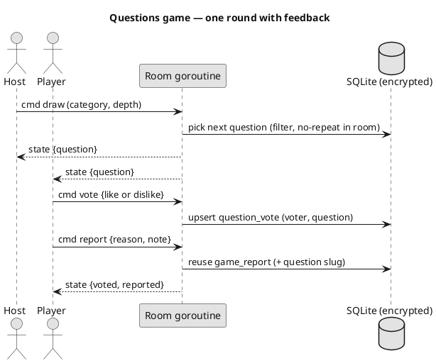

```table-of-contents
```

# Questions game: design & analysis

Research and design for a **conversation / prompt-deck game** on the existing multiplayer engine, in the vein of Esther Perel's *Where Should We Begin*, the Dutch *Openhartig* series, The School of Life's question card sets and the *36 Questions* set. This note is the before-any-code brief: the design space it draws from, the open-source references worth reusing (content, not forks), how it plugs into the `Game` engine (see [[TotemApp-IT-Games]]), and the three features that shape it: per-question **like/dislike**, question **categories** (set still to be determined), and reuse of the existing in-room **report-a-problem** flag plus a **suggest-a-question** path. The game is not built yet; this is the design of record and the [main README](../README.md#issues--roadmap) carries the single roadmap entry.

## Concepts

Domain terms used throughout this note, defined once here.

- **Question** — one prompt shown to the room (`text` in it/en/nl, a stable `slug`). The content, exactly as the totem catalogue is the content of the finder.
- **Category** — a grouping of questions (icebreaker, deep, relationship, etc.). The concrete set is **to be determined** (see [Categories](#categories-to-be-determined)); a question may end up single-category or multi-tag, itself an open choice.
- **Depth** — an orthogonal intensity axis (light, medium, deep) borrowed from the reference decks, so a round can ramp intimacy regardless of category.
- **Like / dislike** — a per-player, per-question reaction (`+1` / `-1`). Aggregated server-side to weight the draw and to surface weak questions for review. Not a score: the game has no winner, like *Where Should We Begin*.
- **Report** — the existing in-room "there is a problem" flag (the shared `GameReportButton`, `game_report` table, `POST /api/v1/games/reports`), reused unchanged and optionally carrying the current question slug.
- **Suggestion** — a public "add this question" submission, mirroring the finder's community *suggest a new animal* path.

## The design space (what already exists)

All of these are physical card decks (or simple apps). Their **mechanics are fair to emulate; their actual card text is not** (see [Licensing](#licensing-design-decision--risk--mitigation)). The useful output is the shape of play, not the wording.

| Deck / app | Type | Mechanic worth borrowing | Content status |
| --- | --- | --- | --- |
| Esther Perel — *Where Should We Begin* | Co-op storytelling, no winner | Rotating storyteller, a drawn prompt, everyone answers, SFW/explicit split | Copyrighted text |
| *Openhartig* (NL) | Themed conversation starters | Themed editions (Classic, Dating, Zingeving, About Sex) map cleanly to categories | Copyrighted text |
| The School of Life — *100 Questions*, *Know Yourself*, *Meeting Friends* | Conversation / self-knowledge | Audience-scoped sets (friends, couples, self), single prompt per card | Copyrighted text |
| *We're Not Really Strangers* | Tiered intimacy | Three explicit levels (Perception, Connection, Reflection): the depth ramp | Copyrighted text |
| *36 Questions* (Aron et al.) | Research protocol | Three sets of increasing closeness, a known public research instrument | Freely published, many clones |

Three families fall out of this: **co-op storytelling** (closest to nothing we have yet, nearest existing game is Wavelength's prompt draw), **deep / intimate conversation decks** (the bulk: Openhartig, School of Life, WNRS), and **light party prompts** (would-you-rather, hot takes). The one lever every good version shares is a **depth ramp** from light to deep, which is why `depth` is a first-class field above.

## Open-source references

The honest finding: there is no famous, maintainable, fork-this multiplayer deep-question repo. The ecosystem is Cards-Against-Humanity engines plus static question lists. Our engine already provides rooms, seats, reconnect and transport, so **we reference, we do not fork**. What is genuinely reusable is openly licensed **content**.

| Repo | What it is | License | Use for us |
| --- | --- | --- | --- |
| [`jackships/conversation-topics`](https://github.com/jackships/conversation-topics) | 910 hand-written topics as JSON (icebreaker, conversation, deep-question, debate, speech, writing, journal), tagged by audience and depth, plus a no-repeat picker | MIT (code) + CC BY 4.0 (data) | **Primary content source.** Maps directly onto our deck pattern; CC BY needs only attribution, which we already give upstream sources |
| [`cynicaloptimist/longwave`](https://github.com/cynicaloptimist/longwave) | Our existing Wavelength deck source | Open | Pattern reference for a prompt-draw game and how we credit a content source in `*_cards.go` |
| *36 Questions* (Aron) implementations | Static SPAs over the public research set | Varies | Content seed only, nothing to fork |
| Pretend You're Xyzzy / [`daem-on/snazzy`](https://github.com/daem-on/snazzy) | Self-hosted CAH engines | Unstated / mixed | Reference for room UX only; the engine we would duplicate, so not used |

## Proposed game (fit to the engine)

One file `internal/game/questions.go` implementing the `Game` interface, registered by slug in `gameFactories` (`engine.go`), **event-driven** (`TickHz() == 0`) like every non-Bomberman game. State is mostly **public** (the current question is shown to the whole room), so unlike Codenames or Love Letter it needs no secret per-seat view in v1; a later "guess who wrote that" variant would add one. Client side is the usual set: a page under `src/web/src/games/`, a `rules.ts` entry, i18n keys in it/en/nl, a `GamesPage.tsx` card and an `App.tsx` route. **UI placement of the like/dislike and report controls in the room is an open decision, not an assumption** (see [Open questions](#open-questions)); per the room rules, dice/action slots are never overloaded, so these likely live in or beside the room bar.



### Data model (proposed)

The catalogue seeds from `data/questions.json` (the pattern the quiz roadmap already prefers over embedding). Votes, reports and suggestions are **runtime state**, so they live in the DB, not in an embedded Go slice like `wavelengthCards` / `codenamesWords`.

```sql
-- 000N_questions.sql  (embedded, applied on startup, tracked in schema_migrations)

CREATE TABLE question (
  id       INTEGER PRIMARY KEY,
  slug     TEXT UNIQUE NOT NULL,                          -- stable key, like the totem slug
  category TEXT NOT NULL,                                 -- see Categories (TBD)
  depth    TEXT NOT NULL CHECK (depth IN ('light','medium','deep')),
  status   TEXT NOT NULL DEFAULT 'active' CHECK (status IN ('active','hidden'))
);

CREATE TABLE question_vote (                              -- one like/dislike per voter per question
  question_id INTEGER NOT NULL REFERENCES question(id),
  voter       TEXT    NOT NULL,                           -- seat+room token in v1; a persisted id later
  value       INTEGER NOT NULL CHECK (value IN (-1, 1)),  -- dislike / like
  PRIMARY KEY (question_id, voter)                        -- re-vote overwrites, never duplicates
);

CREATE TABLE question_suggestion (                        -- "add this question" (mirrors suggestion in 0003)
  id        INTEGER PRIMARY KEY,
  text      TEXT NOT NULL,
  text_norm TEXT UNIQUE NOT NULL,                         -- dedupe; repeat submits upsert count+1
  category  TEXT,
  note      TEXT,
  count     INTEGER NOT NULL DEFAULT 1,
  status    TEXT NOT NULL DEFAULT 'pending' CHECK (status IN ('pending','accepted','rejected'))
);

-- Reports reuse the existing 0004_game_reports.sql path unchanged; the row optionally
-- carries the current question slug so moderation knows which prompt was flagged.
-- A dedicated question_report table is only worth adding if we later want per-question report counts.
```

### API (proposed)

Mirrors the existing contract and its hardening (bounded body, validation, per-IP rate limit, `202 {"status":"received"}` on writes).

| Method & path | Purpose | Body |
| --- | --- | --- |
| `GET /api/v1/questions` | Draw pool / browse | `lang`, `category`, `depth` |
| `POST /api/v1/questions/{slug}/vote` | Like or dislike | `{value: "like"\|"dislike"}` |
| `POST /api/v1/question-suggestions` | Suggest a new question | `{text, category?, note?}` |
| `POST /api/v1/games/reports` | Report a problem (existing) | `{reason, note?}` (+ optional question slug) |

In-room, vote and report also travel over the WebSocket `Command` (`cmd vote`, the shared report flag), consistent with the engine; the POST endpoints serve catalogue browse and the out-of-room suggest path. Review stays CLI-only (`totem-admin`), no HTTP admin surface, as with animal suggestions and game reports.

## Categories (to be determined)

The concrete category set is **an open design choice**, flagged here rather than decided. A candidate starter set, aligned with the reference decks and the `conversation-topics` tags, to react to:

| Candidate category | Rough intent | Nearest reference |
| --- | --- | --- |
| Icebreaker | Low-stakes openers for a new group | School of Life *Meeting Friends*, conversation-topics `icebreaker` |
| Getting to know you | Everyday personal questions | Openhartig *Classic* |
| Deep / reflective | Values, fears, meaning | WNRS level 3, Openhartig *Zingeving*, `deep-question` |
| Relationship | For couples or close friends | *Where Should We Begin*, Openhartig *Dating* |
| Know yourself | Self-directed reflection | School of Life *Know Yourself* |
| Playful / would-you-rather | Light party prompts | would-you-rather lists |

Two decisions still open: the **final set** (above is a strawman), and whether a question carries **one category or several tags** plus a `depth`. Multi-tag is more flexible for the draw filter but needs a join table rather than the single `category` column sketched above.

## Feedback: votes, reports, suggestions

The three feedback features reuse what the app already has, rather than inventing parallel machinery.

- **Like / dislike** is new but small: a `question_vote` upsert keyed on (question, voter), aggregated into a like-rate per question. Uses: bias the draw toward liked questions, and list low-rated or high-dislike questions for review in `totem-admin`. It is explicitly **not** a player score.
- **Report a problem** is the existing in-room flag, present in every room bar today (the `GameReportButton`, `game_report` table, `totem-admin game-reports`). The questions game ships it unchanged; the only addition is passing the current question slug so a report is actionable.
- **Suggest a question** mirrors the finder's *suggest a new animal* exactly: a hardened public `POST`, `ON CONFLICT` dedupe with a count, `status ∈ {pending, accepted, rejected}`, reviewed over SSH. An accepted suggestion scaffolds a draft `question` row.

## Licensing (Design Decision / Risk / Mitigation)

Same discipline as the finder's [data provenance](../README.md#data-provenance--licensing) section. Short answer to "can they do anything if I write my own version of the same question": individual short factual questions are not protectable, so original wording on the same themes is fine; copying their exact text or lifting a whole curated deck is not. *(Not legal advice.)*

| Concern | Design Decision / Risk / Mitigation |
| --- | --- |
| Commercial deck text (Perel, Openhartig, School of Life, WNRS) | **Decision:** never copy card wording. **Risk:** verbatim text is copyrightable expression. **Mitigation:** emulate mechanics only; author original questions or use an openly licensed set. |
| Curated selection & arrangement | **Risk:** copying a whole deck's set and ordering can infringe as a compilation even if single questions do not. **Mitigation:** build our own set / categories; do not mirror a specific deck end to end. |
| Deck and product names | **Risk:** "Where Should We Begin", "Openhartig" etc. are trademarks. **Mitigation:** do not name categories or the game after them. |
| Open content (`jackships/conversation-topics`) | **Decision:** seed from it. **Risk:** CC BY 4.0 requires attribution. **Mitigation:** credit "conversation-topics by Jack Ships" with a link, as we already credit Wavelength and Codenames sources in their `*_cards.go` headers. |
| Original questions | **Benefit:** no third-party rights at all, and doubles as quality control. Preferred for any wide or non-personal release. |

## Open questions

Genuine design decisions to settle before building, not a task list.

- **Categories:** final set, and single-category vs multi-tag per question.
- **UI placement:** where the like/dislike and report controls live in the room (ask before building, per the room-bar rule).
- **Content storage:** `data/questions.json` seed into the DB (needed anyway for votes/reports) versus an embedded Go slice as other decks use.
- **Vote identity:** per seat per room in v1, or a persisted per-question tally; and the dedupe key that follows.
- **Scope of v1:** plain "draw and discuss" first, or the *Where Should We Begin* storyteller loop from the start.

## Changelog

- **0.21.1 (2026-10-17)** — Initial analysis note. Surveyed existing question decks (Perel, Openhartig, School of Life, WNRS, 36 Questions) and open-source references (`jackships/conversation-topics` as the content source; CAH engines and 36-questions SPAs as reference only). Proposed engine fit (one event-driven `Game`), per-question like/dislike, a TBD category set, and reuse of the existing report flag plus a suggest-a-question path. Nothing built yet.

## References

- [jackships/conversation-topics](https://github.com/jackships/conversation-topics) (MIT + CC BY 4.0 content, recommended source)
- [cynicaloptimist/longwave](https://github.com/cynicaloptimist/longwave) (our Wavelength deck source)
- [daem-on/snazzy](https://github.com/daem-on/snazzy) (self-hosted Cards Against Humanity engine, reference only)
- [Where Should We Begin: how to play](https://estherperel.com/how-to-play-where-should-we-begin)
- [The School of Life: Games & Card Sets](https://www.theschooloflife.com/games-card-sets)
- [Openhartig gespreksstarters](https://www.bol.com/nl/nl/p/openhartig-classic-gespreksstarter/1004004011106956/)
- [[TotemApp-IT-Games]] (the engine) · [[TotemApp-IT]] (the main README)
